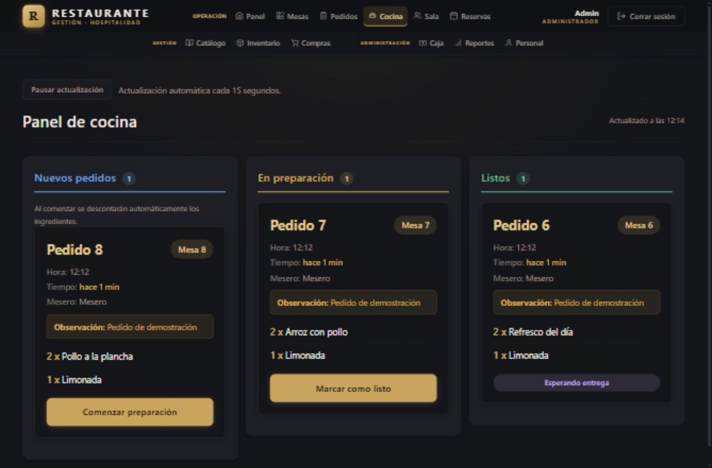

# Sistema de gestión para restaurantes

Aplicación web desarrollada con **Python, Django y PostgreSQL** para coordinar mesas, pedidos, cocina, sala, caja e inventario. Incluye compras, reservas, personal y reportes de ventas.

El proyecto permite seguir un pedido desde su registro hasta el cobro: al comenzar la preparación valida las recetas y descuenta ingredientes; al cobrar registra el pago y libera la mesa.



## Funciones principales

| Área | Funciones |
|---|---|
| Mesas y pedidos | Estados de mesa, productos, cantidades, observaciones y totales |
| Cocina y sala | Preparación, pedidos listos y entrega; actualización cada 15 segundos |
| Caja | Efectivo, tarjeta, Yape y Plin; cálculo de vuelto y cierre diario |
| Inventario | Ingredientes, recetas, movimientos, stock mínimo e historial |
| Compras | Proveedores, órdenes y recepción con ingreso de stock |
| Reservas | Clientes, capacidad, validación de horarios y detección de solapamientos |
| Personal | Roles de administrador, mesero, cocina y cajero; activación y desactivación |
| Reportes | Ventas por periodo, métodos de pago, productos más vendidos y exportación CSV |

## Capturas

Todas las imágenes utilizan datos ficticios de la base de demostración.

| Pantalla | Vista |
|---|---|
| Panel principal | [Abrir captura](docs/capturas/01-panel.png) |
| Mesas | [Abrir captura](docs/capturas/02-mesas.png) |
| Cocina | [Abrir captura](docs/capturas/03-cocina.png) |
| Inventario | [Abrir captura](docs/capturas/04-inventario.png) |
| Caja | [Abrir captura](docs/capturas/05-caja.png) |
| Reportes | [Abrir captura](docs/capturas/06-reportes.png) |
| Cocina en tablet | [Abrir captura](docs/capturas/07-cocina-tablet.png) |
| Cocina en celular | [Abrir captura](docs/capturas/08-cocina-movil.png) |

## Tecnologías

- Python 3.12+, Django 6.0.8 y PostgreSQL 15+.
- psycopg 3.3.4 y python-decouple 3.8.
- Plantillas Django, HTML, CSS y JavaScript sin dependencias de frontend.
- Pruebas de Django y pruebas JavaScript con el ejecutor integrado de Node.js.

## Instalación local

Necesitas Python, PostgreSQL y Git. En PowerShell:

```powershell
git clone https://github.com/AngelChB/sistema-restaurante.git
cd sistema-restaurante
python -m venv venv
.\venv\Scripts\Activate.ps1
python -m pip install -r requirements.txt
if (-not (Test-Path .env)) {
    Copy-Item .env.example .env
}
notepad .env
```

Si ya tienes `.env`, conserva ese archivo. Completa las credenciales de PostgreSQL y genera una clave para `SECRET_KEY`:

```powershell
python -c "from django.core.management.utils import get_random_secret_key; print(get_random_secret_key())"
```

Desde pgAdmin, conectado a la base `postgres`, crea una base nueva si todavía no existe:

```sql
CREATE DATABASE restaurante_db;
```

El usuario `postgres` ya se crea durante la instalación de PostgreSQL; utiliza su contraseña existente. Luego:

```powershell
python -m pip check
python manage.py check
python manage.py migrate
python manage.py createsuperuser
python manage.py runserver
```

Abre <http://127.0.0.1:8000/>. La cuenta del sistema web es independiente de la cuenta de PostgreSQL. Una base nueva no contiene productos ni recetas: puedes crear tus registros o usar la demostración separada.

## Demostración con datos ficticios

La configuración `config.settings_demo` usa por defecto la base **restaurante_demo**, sin cambiar `DB_NAME` en `.env`. Las cookies de la demo tienen nombres propios para no interferir con la sesión habitual.

Crea una vez la base desde pgAdmin:

```sql
CREATE DATABASE restaurante_demo;
```

Ejecuta:

```powershell
python manage.py migrate --settings=config.settings_demo
python manage.py cargar_demo --settings=config.settings_demo
python manage.py runserver 127.0.0.1:8002 --settings=config.settings_demo
```

Abre <http://127.0.0.1:8002/>. El cargador exige una base vacía cuyo nombre termine en `_demo`; una segunda ejecución se detiene sin sobrescribir registros. `DB_NAME_DEMO` permite elegir otro nombre terminado en `_demo`.

| Cuenta de demostración | Rol |
|---|---|
| `admin_demo` | Administrador del restaurante |
| `mesero_demo` | Mesero |
| `cocina_demo` | Cocina |
| `caja_demo` | Cajero |

Clave de estas cuentas locales de demostración: **`DemoRestaurante123!`**. Son cuentas ficticias para ejecutar la demo en tu equipo; no son las credenciales de tu base habitual.

La carga crea 8 mesas, 6 productos y recetas, 6 ingredientes, una compra recibida, 8 pedidos, 4 pagos y 2 reservas. Los ingresos de inventario, la preparación y los cobros pasan por las mismas operaciones del sistema. Las fechas se generan al cargar la demo; las capturas muestran la fecha de su preparación.

[Guion de presentación de cinco minutos](docs/DEMO.md).

## Reglas implementadas

- Los productos y cantidades solo se cambian mientras el pedido está abierto.
- Un pedido pagado necesita un cobro por su total y no puede volver a abierto o cancelado conservando ese cobro.
- Iniciar preparación valida recetas y stock y registra los consumos dentro de una transacción.
- Los servicios de recepción y preparación evitan procesar la misma operación dos veces.
- Las compras finalizadas y los datos de cobro quedan protegidos en los flujos de la aplicación.
- Pedidos y reservas se serializan por mesa; cobros y cierres del día comparten un bloqueo en PostgreSQL.
- El servidor comprueba roles y la propiedad de pedidos de meseros.
- El CSV usa hora de Lima y protege los textos editables que podrían interpretarse como fórmulas.

## Pruebas

```powershell
python manage.py test
```

Se usa una base temporal separada, que Django elimina al terminar. La cuenta de PostgreSQL usada para pruebas debe poder crear bases. Las pruebas de concurrencia requieren PostgreSQL y se omiten en SQLite.

Para comprobar el JavaScript, con Node.js instalado:

```powershell
node --test tests_js/panel-live.test.cjs tests_js/formset.test.cjs
```

La suite cubre permisos, formularios, operaciones simultáneas y el recorrido completo de crear, preparar, entregar y cobrar un pedido. La comprobación responsive realizada incluye cocina a 1366, 768 y 390 píxeles y la apertura del menú móvil; no sustituye una revisión de accesibilidad de todo el producto.

## Estructura

```text
config/       Configuración, rutas y entorno de demostración
core/         Panel, filtros, fechas, paginación y carga de demo
pedidos/      Pedidos, detalles y reglas de edición
cocina/ sala/  Preparación y entrega
caja/         Cobros y cierres diarios
inventario/   Ingredientes, recetas y movimientos
compras/      Proveedores, órdenes y recepción
personal/     Usuarios, roles y permisos
reservas/     Clientes y horarios
reportes/     Ventas y exportación CSV
templates/    Pantallas del sistema
static/       CSS, JavaScript e imágenes
docs/         Capturas y guion de demostración
```

## Alcance

Proyecto de portafolio con ejecución local. Todavía no integra facturación electrónica, pasarelas de pago, devoluciones ni un flujo completo de mermas. Registrar un pago no ejecuta una transacción bancaria. Un despliegue público requiere configuración de producción, servidor de aplicación, estáticos y copias de seguridad; no se debe publicar con `runserver` ni con las claves de demostración.

No se ha añadido una licencia de distribución. El archivo `.env`, las bases de datos y las credenciales reales no deben subirse al repositorio.


## Estilo de código

El formato e imports de Python se mantienen con Ruff. Es una herramienta de desarrollo y no se necesita para ejecutar el restaurante.

```powershell
python -m pip install -r requirements-dev.txt
python -m ruff check .
python -m ruff format --check .
```

Para aplicar formato: `python -m ruff format .`. La configuración está en `pyproject.toml`; se excluyen el entorno virtual y las migraciones.
